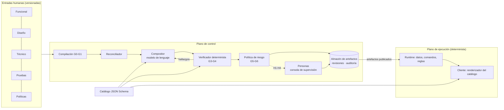
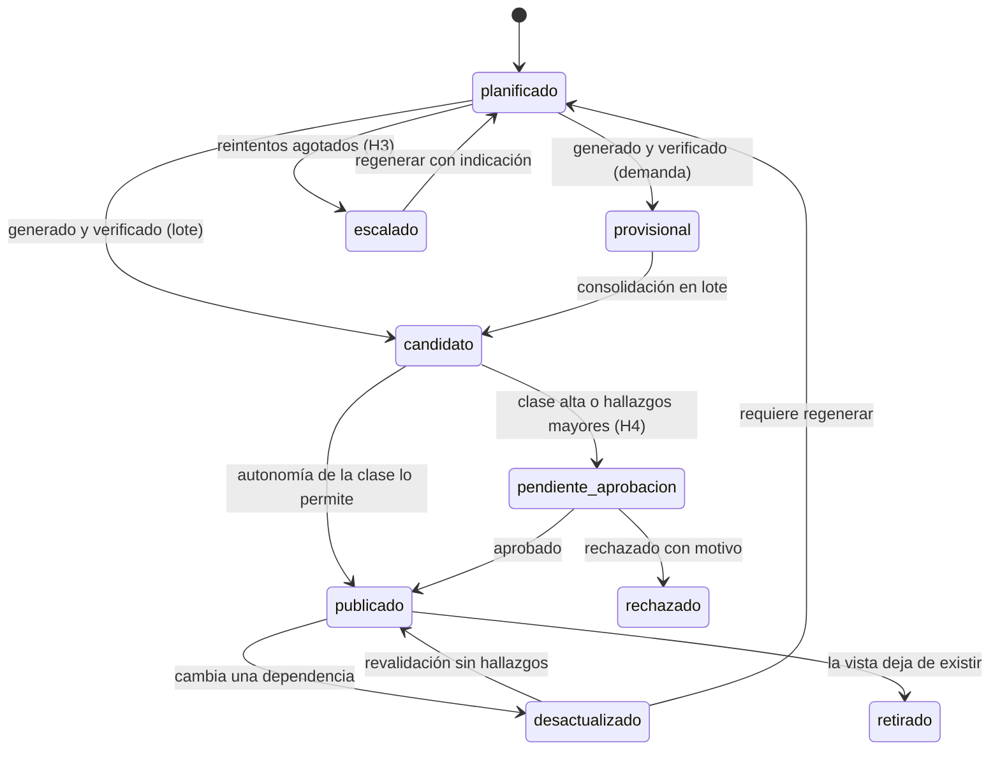

<div align="center">

# Eidos

<sub>εἶδος · la forma de la que cada pantalla es una instancia</sub>

**Arquitectura dirigida por especificaciones y diseño para la construcción verificada de interfaces de gestión con modelos de lenguaje**


[](LICENSE)


[Documentación](docs/README.md) · [Arquitectura](docs/02-arquitectura.md) · [Puntos de control](docs/04-puntos-de-control.md) · [Plan](docs/09-plan-de-trabajo.md) · [Referencias](docs/referencias.md)

[English](README.md) · **Español**

</div>

> *Lo que se escribe es la forma; lo que se ve, una de sus instancias. La forma permanece mientras las instancias se regeneran.*

---

## Resumen

En las aplicaciones de gestión, buena parte del coste de desarrollo y mantenimiento está en traducir requisitos, reglas y criterios de diseño a interfaces. Ese trabajo es en gran medida repetitivo y, al acumularse los cambios, el código se aleja de la especificación que lo originó. Esta prueba de concepto explora una arquitectura en la que **las especificaciones funcionales, técnicas, de diseño y de prueba son los artefactos primarios y versionados del proyecto**, y la interfaz es un **artefacto derivado**. El propósito es observar cómo se comporta el ciclo de desarrollo cuando el trabajo se centra en especificar y diseñar: qué se puede derivar, qué falla, dónde hace falta una persona y qué cuesta.

Un plano de control con agentes basados en modelos de lenguaje deriva la interfaz dentro de un vocabulario cerrado (catálogo de componentes descrito en JSON Schema). Un verificador determinista la comprueba frente a la especificación. Una política declarativa, función del riesgo calculado, decide qué se publica automáticamente y qué requiere aprobación humana. El plano de ejecución es determinista: los modelos no participan en la lectura ni en la escritura de datos.

La arquitectura se apoya en resultados establecidos:
- desarrollo dirigido por modelos con lenguajes específicos y acotados [R5][R6];
- interfaces declarativas sobre catálogo de confianza [R8][R10];
- decodificación restringida por esquema [R7];
- reparación guiada por retroalimentación externa y no por autoevaluación [R12][R13];
- reconciliación de estado deseado [R28];
- niveles de automatización por función y riesgo [R23].

La implementación de referencia (Python, unas 2.700 líneas; cliente TypeScript, unas 600) se ha evaluado sobre dos dominios pequeños. Los resultados son preliminares y no permiten conclusiones generales. Sobre 14 vistas:
- con un modelo abierto ejecutado en local (gpt-oss:20b), 7 (50 %) superaron la verificación en el primer intento y 9 (64 %) tras reparación guiada;
- con un modelo comercial pequeño (gpt-4o-mini), 8 (57 %) y 11 (79 %), respectivamente.

El resto se escaló a una persona según la política. El objetivo fijado para la fase es ≥ 90 % en el primer intento.

**Palabras clave:** desarrollo dirigido por especificaciones, ingeniería dirigida por modelos, interfaces generadas, modelos de lenguaje, verificación, supervisión humana, trazabilidad.

---

## 1. Introducción

### 1.1 Problema

Brooks distingue entre complejidad **esencial**, propia del problema (datos, reglas, flujos), y **accidental**, propia de los medios de implementación [R1]. En aplicaciones de gestión, la construcción de formularios, listados, detalles y confirmaciones concentra mucha complejidad accidental: es estructuralmente parecida entre aplicaciones, pero cada instancia se escribe, prueba y mantiene a mano.

Las leyes de Lehman establecen además que un sistema en uso debe cambiar continuamente y que su complejidad crece salvo que se invierta en reducirla [R2]. Cada cambio funcional se propaga hoy a código de interfaz. La trazabilidad entre requisito, implementación y prueba, que la norma ISO/IEC/IEEE 29148 exige [R18], se degrada porque se mantiene a mano [R19].

### 1.2 Planteamiento

No se pretende eliminar la programación ni sustituir el proceso de desarrollo existente. Se trata de **analizar qué ocurre con el ciclo de desarrollo si el esfuerzo se centra en las especificaciones y en el diseño**:
- si la coherencia entre lo especificado y lo construido puede mantenerse y demostrarse con evidencia;
- qué parte del trabajo se desplaza;
- qué nuevos costes aparecen.

En esta prueba de concepto, el equipo produce y mantiene cuatro familias de entradas: documento funcional, sistema de diseño, especificación técnica y pruebas. A ellas se añaden las políticas que gobiernan la automatización. La plataforma deriva de ellas los artefactos de interfaz, los verifica, registra la evidencia y solicita intervención humana en los puntos que fija la política.

El reparto de responsabilidades con el que se experimenta es el siguiente:

| Actor | Responsabilidad |
|---|---|
| Analistas funcionales y diseño | Definen requisitos, criterios de aceptación, patrones y tono; validan el resultado |
| Desarrollo | Mantiene la especificación técnica, las reglas de negocio y los componentes que no encajan en el catálogo; aprueba publicaciones de riesgo alto |
| Equipo de IA | Mantiene la plataforma: agentes, verificador, políticas y perfiles de modelo |
| Sistema | Construye, verifica y repara los artefactos derivados, y decide (por política declarada) cuándo intervenir y a quién asignar la intervención |

### 1.3 Aportaciones de la prueba de concepto

1. Un **modelo de artefactos** que separa entradas humanas inmutables para el sistema, especificación compilada y artefactos derivados con ciclo de vida, dependencias declaradas y revisiones.
2. Una **separación estricta entre plano de control** (agentes, reconciliación, verificación, política) **y plano de ejecución** (datos, comandos, renderizado), de modo que ninguna respuesta de un modelo actúa sobre los datos.
3. Un **sistema de puertas (G0–G7) y de intervenciones (H1–H6)** cuya activación depende de una clase de riesgo calculada a partir de la especificación, no elegida caso a caso.
4. Mecanismos para **evitar la deriva ad hoc** de la plataforma: funciones de aptitud automatizadas [R31] y un segundo dominio testigo.
5. Una **implementación de referencia** abierta a inspección, con contratos exportados en JSON Schema.

---

## 2. Hipótesis y preguntas de investigación

**Hipótesis.** En aplicaciones de gestión de complejidad baja o media, si las entradas humanas son precisas, verificables y trazables, un generador basado en modelos de lenguaje puede producir la mayoría de las vistas. Debe hacerlo restringido a un catálogo cerrado y verificado por un oráculo determinista. El esfuerzo humano se concentra entonces en la especificación y en un número acotado de decisiones de aprobación.

| Id | Pregunta | Métrica | Objetivo de la fase |
|---|---|---|---|
| PI1 | ¿Qué proporción de vistas supera la verificación sin intervención? | % de vistas válidas en el primer intento y tras reparación, por perfil de modelo | ≥ 90 % en el primer intento |
| PI2 | ¿Puede mantenerse la trazabilidad requisito → especificación → vista → prueba sin trabajo manual? | % de requisitos con cadena completa | 100 % |
| PI3 | ¿Puede limitarse la intervención humana a decisiones fijadas por política? | Intervenciones por cambio funcional; proporción justificada por regla | Todas justificadas |
| PI4 | ¿Se mantiene la plataforma independiente del dominio? | Violaciones de funciones de aptitud con dos dominios | 0 |
| PI5 | ¿Depende el resultado del proveedor de modelo? | Diferencia de PI1 entre perfiles (local / cloud) | Por medir |
| PI6 | ¿Se cumple la minimización de datos con modelos externos? | Datos reales en prompts a perfiles externos | 0 |

---

## 3. Fundamentos y trabajo relacionado

**Ingeniería dirigida por modelos.** MDA [R3] y MDE [R4] formalizaron la generación de software a partir de modelos. Los estudios empíricos en industria atribuyen los beneficios a lenguajes específicos pequeños aplicados a partes concretas del sistema, en convivencia con código manual. Los fracasos aparecen al intentar modelarlo todo [R5][R6]. Eidos adopta esas condiciones: especificaciones estrechas y validadas, catálogo cerrado y una ruta manual de primera clase.

**Interfaces declarativas.** Los sistemas *server-driven UI* en producción [R10] y las especificaciones recientes para interfaces generadas por agentes, A2UI [R8] y json-render [R9], describen la interfaz como datos interpretados por un cliente que solo conoce componentes de confianza. Eidos adopta un documento de pantalla plano, alineado con A2UI, con enlaces a datos mediante JSON Pointer (RFC 6901).

**Generación restringida y corrección.** La decodificación restringida por esquema garantiza la validez sintáctica [R7], pero no la semántica. La evidencia indica que los modelos no se autocorrigen de forma fiable sin retroalimentación externa [R12] y que la eficacia de la reparación depende de la calidad de esa retroalimentación [R13][R14][R15][R16]. Los modelos usados como jueces presentan sesgos documentados [R17]. Por ello, en Eidos el oráculo es determinista y escrito por personas, y la reparación solo se activa con un hallazgo concreto (patrón *evaluator-optimizer* [R11]).

**Requisitos y aceptación.** Se adoptan los criterios de calidad de requisitos de ISO/IEC/IEEE 29148 [R18], los ejemplos ejecutables de *Specification by Example* y BDD [R20][R21] y el lenguaje ubicuo de DDD [R22]. El sistema comprueba el uso coherente del glosario.

**Supervisión humana.** El nivel de automatización se asigna por función y riesgo [R23]. Las intervenciones se diseñan pequeñas y con evidencia para mitigar las ironías de la automatización [R24][R25], en línea con NIST AI RMF [R26] y con el artículo 14 del Reglamento europeo de IA [R27].

**Arquitectura.** Se toman la reconciliación de estado deseado de Borg/Kubernetes [R28], las tuberías con puertas de calidad [R29], las funciones de aptitud [R31], la ocultación de información y los contratos [R32][R33], y los puertos y adaptadores para los proveedores de modelo [R34]. Los riesgos específicos de los sistemas con aprendizaje automático (dependencias no declaradas, código de pegamento) [R35][R36] se tratan con dependencias explícitas por artefacto.

### 3.1 Posicionamiento

| Enfoque | Qué produce | Quién lo mantiene | Diferencia con Eidos |
|---|---|---|---|
| MDE clásico | Código mediante transformaciones fijas | Personas (modelos y generadores) | El generador interpreta lenguaje natural y diseño; la salida es declarativa y se verifica |
| Low-code visual | Pantallas compuestas a mano en un editor | Personas | No hay editor de pantallas; se especifica qué se necesita, no cómo se dibuja |
| Agentes de código guiados por especificación (p. ej. Spec Kit [R37]) | Código fuente | Personas, tras la generación | Eidos no genera código: genera documentos acotados que el propio sistema reconcilia y verifica |
| Server-driven UI | Documentos de interfaz escritos por equipos | Personas | Eidos automatiza la autoría bajo verificación y política |

---

## 4. Arquitectura

La descripción completa está en [docs/02-arquitectura.md](docs/02-arquitectura.md). Esta sección resume sus elementos.

### 4.1 Entradas

Cada aplicación es un paquete de entradas versionado (ejemplo: [apps/usuarios/](apps/usuarios)). El sistema no las modifica (RP-03); solo puede proponer cambios como intervención.

| Familia | Contenido | Propietario | Formato |
|---|---|---|---|
| Funcional | Requisitos con actor y criterio de aceptación, glosario | Funcional | YAML validado |
| Diseño | Voz y tono, patrones aplicables, restricciones de composición | Diseño | YAML validado |
| Técnico | Entidades, campos, reglas, métricas, vistas, comandos | Desarrollo | YAML validado |
| Pruebas | Pruebas de conformidad por vista (BDD en la Fase 2) | Funcional + Desarrollo | YAML validado |
| Políticas | Clases de riesgo y autonomía (sobre valores por defecto de plataforma) | Desarrollo | YAML |

### 4.2 Planos y componentes



El **catálogo** de componentes, definido en JSON Schema, es la única fuente para tres usos: el esquema de salida del modelo, las reglas del verificador y el registro del renderizador. Un componente que no esté en el catálogo no puede generarse, aceptarse ni dibujarse.

El **intérprete** de lenguaje natural del usuario final traduce peticiones a una vista y unos parámetros declarados. No recibe registros de datos: la resolución de registros se hace en el servidor.

### 4.3 Ciclo de vida de un artefacto de pantalla



Cada revisión registra sus **dependencias por huella**: fragmento de especificación, receta, catálogo, sistema de diseño y pruebas. Un cambio de entradas solo afecta a los artefactos cuyas huellas cambian. Los artefactos publicados son inmutables (RP-06): regenerar exige un cambio de dependencia o una decisión humana registrada, y la versión publicada se sigue sirviendo hasta que la nueva supere las puertas. Detalle en [docs/03-ciclo-de-vida.md](docs/03-ciclo-de-vida.md).

### 4.4 Puertas de calidad

| Puerta | Comprobación | Si falla |
|---|---|---|
| G0 Admisión | Entradas válidas contra su esquema; requisitos identificados, con actor y criterio | Versión rechazada con errores localizados |
| G1 Compilación | Integridad referencial, ambigüedades, trazabilidad, huellas | H1 (aclarar o aprobar especificación) |
| G2 Planificación | Patrón, clase de riesgo y ruta (demanda / lote / manual) por vista | H2 (clase alta o manual) |
| G3 Generación | Salida estructurada; estructura y grafo de componentes; enlaces a datos | Reparación con hallazgos o H3 |
| G4 Verificación | Reglas de diseño; pruebas de conformidad | Reparación con hallazgos o H3 |
| G5 Aprobación | Autonomía de la clase; requisitos con prueba (RP-05) | H4 (aprobar publicación) |
| G6 Publicación | Versión completa; reversión disponible | Se mantiene la versión anterior |
| G7 Operación | Señales de ejecución | Revalidación o H6 |

El verificador distingue cuatro severidades: bloqueante, mayor, menor y autocorregible. Las correcciones automáticas son transformaciones deterministas y anotadas (normalizar la estructura, aplanar componentes anidados, etc.) y no consumen reintentos.

### 4.5 Riesgo, autonomía e intervención

La **clase de riesgo** (baja, media, alta o manual) se calcula a partir de la especificación: escritura de datos, operaciones irreversibles, permisos, reglas críticas, número de entidades y regiones. Es el máximo de los factores. Cada clase se asocia a un **nivel de autonomía** (A0–A3) por función [R23]:
- Una vista de consulta de clase baja se publica sin aprobación previa, con auditoría por muestreo.
- Una baja de registros (clase alta) requiere aprobación (H4).
- Cambiar la especificación siempre requiere aprobación (H1).
- Cambiar pruebas no está permitido al sistema en ningún caso.

Detalle en [docs/04-puntos-de-control.md](docs/04-puntos-de-control.md).

### 4.6 Invariantes de plataforma (selección)

| Id | Invariante |
|---|---|
| RP-01 | Ningún artefacto llega a usuarios finales sin superar G3 y G4 |
| RP-02 | Los agentes no escriben datos; toda escritura es un comando declarado, validado y auditado |
| RP-03 | El sistema no modifica entradas humanas |
| RP-04 | No se repara sin un hallazgo que lo motive |
| RP-05 | Un requisito sin prueba aprobada bloquea la publicación de sus artefactos |
| RP-07 | Ningún dato real viaja a perfiles de modelo externos |
| RP-10 | La plataforma no contiene conocimiento de dominio |

### 4.7 Contratos

Los contratos entre componentes se exportan a [contracts/](contracts) como JSON Schema 2020-12: especificación compilada, vista, entidad, comando, regla, documento de pantalla, hallazgo, artefacto e intervención. Los adaptadores de modelo (Ollama local, Azure OpenAI y un perfil determinista de referencia) implementan una única interfaz. Las decisiones de diseño están registradas como ADR en [docs/07-decisiones.md](docs/07-decisiones.md).

---

## 5. Implementación de referencia

| Módulo | Responsabilidad |
|---|---|
| [platform/src/eidos/specs](platform/src/eidos/specs) | Admisión (G0) y compilación (G1) |
| [platform/src/eidos/catalog](platform/src/eidos/catalog) | Catálogo de 12 componentes; esquema de pantalla y prompt derivados |
| [platform/src/eidos/patterns](platform/src/eidos/patterns) | Recetas de colección, registro, formulario y confirmación; plantilla de respaldo determinista |
| [platform/src/eidos/agents](platform/src/eidos/agents) | Compositor e intérprete |
| [platform/src/eidos/guard](platform/src/eidos/guard) | Verificador por capas y pruebas de conformidad |
| [platform/src/eidos/policy](platform/src/eidos/policy) | Clasificación de riesgo y autonomía |
| [platform/src/eidos/reconciler.py](platform/src/eidos/reconciler.py), [kinds.py](platform/src/eidos/kinds.py) | Bucle de reconciliación por tipo de artefacto |
| [platform/src/eidos/store.py](platform/src/eidos/store.py) | Revisiones, intervenciones y auditoría (SQLite) |
| [platform/src/eidos/runtime](platform/src/eidos/runtime) | Plano de ejecución: datos, filtros, métricas, comandos y reglas |
| [client/src](client/src) | Renderizador del catálogo y consola de supervisión |

**Dominios de evaluación:**
- `usuarios`: piloto; altas, bajas, edición, listados y métricas.
- `reservas`: testigo; salas y reservas con una regla de no solapamiento.

El dominio testigo existe para detectar conocimiento del piloto filtrado a la plataforma.

---

## 6. Método de evaluación

1. **Construcción por lotes por perfil de modelo.** Para cada dominio y perfil se ejecuta la reconciliación completa (`eidos build all`). Por cada vista se registran los intentos, los hallazgos por puerta y severidad, el modelo, el tiempo y el estado final. El informe se guarda en JSON y Markdown.
2. **Línea base determinista.** El perfil `fake` produce la plantilla de respaldo derivada de las recetas. Sirve como cota inferior de calidad y como control del verificador.
3. **Funciones de aptitud** ([platform/tests/test_fitness.py](platform/tests/test_fitness.py)), ejecutadas en cada cambio:
   - F1: ausencia de vocabulario de dominio en la plataforma;
   - F2/F3: construcción de ambos dominios con las mismas piezas;
   - RP-07: ausencia de datos reales en prompts a perfiles externos.
4. **Pruebas de contrato, verificador, reconciliador, runtime y API** (32 casos con pytest).

---

## 7. Resultados preliminares

**Plataforma.**
- Pruebas automatizadas y funciones de aptitud: 32/32 superadas, incluidas F1, F2, F3 y RP-07.
- Trazabilidad (PI2): 10 de 10 requisitos (5 por dominio) tienen al menos una vista que los implementa y una prueba que los verifica. La matriz se calcula en G1 y un requisito sin prueba bloquea la publicación (RP-05).

**Generación por perfil de modelo (PI1, PI5).** Construcción por lotes de las 14 vistas de los dos dominios; una ejecución por perfil.

| Medida | gpt-oss:20b (local, Ollama, esquema forzado) | gpt-4o-mini (Azure OpenAI, modo JSON) |
|---|---|---|
| Válidas en el primer intento | 7/14 (50 %) | 8/14 (57 %) |
| Válidas tras reparación guiada | 9/14 (64 %) | 11/14 (79 %) |
| Escaladas (H3) | 5/14 | 3/14 |
| Tiempo por intento | 7–47 s (construcción completa ≈ 8 min) | No registrado de forma comparable |

Ninguno de los dos perfiles alcanza el objetivo de la fase (≥ 90 % en el primer intento).

**Análisis de errores.**
- **gpt-4o-mini.** Los fallos fueron mayoritariamente estructurales: componentes anidados en lugar de lista plana, hijos definidos en línea, formato incrustado en rutas de datos y referencias a identificadores inexistentes.
- **gpt-oss:20b.** Las cinco vistas escaladas son de escritura, y cuatro de ellas de clase alta (bajas, y alta y edición de reservas). Dos causas explican todos los bloqueos:
  - referencias a componentes no declarados (`REF_MISSING`, 3 vistas);
  - inclusión del identificador como campo editable en formularios de edición (`FORM_FIELD`, 2 vistas).

  En las bajas, el mismo hallazgo se repitió idéntico tras la reparación. Es decir, una retroalimentación precisa no bastó para corregirlo, lo que apunta a una limitación de la receta o del prompt más que del verificador.

Varios errores estructurales se absorben con normalizaciones deterministas del verificador. Esto mejora el resultado, pero también traslada al verificador parte del mérito atribuible al modelo (véase §8).

---

## 8. Limitaciones y amenazas a la validez

- **Validez interna.**
  - Muestra muy pequeña (14 vistas, una sola ejecución por perfil) y generación no determinista; no se reportan intervalos ni comparaciones estadísticas.
  - Las ejecuciones de los dos perfiles se hicieron en momentos distintos de la iteración, con versiones del prompt y del verificador no idénticas, y con modos de salida estructurada distintos (esquema forzado frente a modo JSON). La comparación entre perfiles es solo orientativa.
  - Las mismas personas escribieron especificaciones, recetas y verificador, lo que puede sesgar el resultado a favor del sistema.
- **Validez de constructo.**
  - «Válida» significa que supera el verificador y las pruebas de conformidad; no implica usabilidad ni aceptación funcional.
  - Aún no hay pruebas de aceptación BDD, juez consultivo ni estudio con usuarios.
- **Validez externa.**
  - Dos dominios de tipo CRUD con pocas entidades.
  - No se ha evaluado con flujos multipaso, integraciones externas, permisos complejos ni volúmenes de datos reales.
- **Dependencia del catálogo.** La expresividad está acotada por el catálogo (12 componentes). Lo que no cabe se clasifica como manual. El equilibrio entre un catálogo demasiado estrecho (encorsetado) y uno demasiado amplio (difícil de verificar) es una cuestión abierta, vigilada con funciones de aptitud (doc. 04 §6).
- **Coste de especificación.** No se ha medido si el esfuerzo de escribir especificaciones verificables compensa el de programar las vistas. Es la pregunta económica central y requiere un estudio comparativo.

### 8.1 Fuera de alcance

- No es un sistema autónomo: las personas definen, aprueban lo que la política les asigna y pueden revertir cualquier publicación.
- No es una herramienta low-code ni genera código fuente arbitrario.
- No sustituye a las pruebas ni las escribe en nombre del equipo.
- No pretende cubrir el 100 % de las vistas; lo que no encaja sigue la ruta manual dentro de la misma arquitectura.

---

## 9. Trabajo futuro

Plan detallado en [docs/09-plan-de-trabajo.md](docs/09-plan-de-trabajo.md) y hoja de ruta en [docs/08-hoja-de-ruta.md](docs/08-hoja-de-ruta.md).

1. **Iteración 1.2.**
   - Batería de evaluación por perfil con repeticiones, para estimar la variabilidad.
   - Ajuste de prompts y recetas.
   - Tipos del cliente generados desde los contratos.
   - Integración continua.
2. **Fase 2.**
   - Capa 4 del verificador (políticas).
   - Pruebas de aceptación BDD como oráculo.
   - Juez consultivo con un perfil distinto del compositor.
   - Intervenciones H1–H6 completas con plazos.
   - Integración con git como fuente de verdad.
   - Eventos en streaming alineados con AG-UI [R38].
3. **Estudio comparativo** del esfuerzo de especificación frente a desarrollo convencional en un dominio real.

---

## 10. Reproducción

**Requisitos:**
- Docker.
- Opcional, para modelos reales: Ollama con `gpt-oss:20b`, o Azure OpenAI configurado en `.env` (plantilla en `.env.example`).

```powershell
.\start.ps1      # plataforma en http://localhost:8000; construye las aplicaciones al arrancar
.\stop.ps1       # detiene los contenedores; los datos se conservan en el volumen
```

| URL | Uso |
|---|---|
| http://localhost:8000 | Aplicaciones `usuarios` y `reservas` (plano de ejecución) |
| http://localhost:8000/console.html | Consola de supervisión: perfil de modelo, construcción, intervenciones, artefactos con vista previa por revisión, regeneración, trazabilidad, auditoría |

```powershell
docker compose exec plataforma eidos validate usuarios           # G0-G1
docker compose exec plataforma eidos build all -v                # reconciliación e informe de conformidad
docker compose exec plataforma eidos interventions list          # intervenciones abiertas
docker compose exec plataforma eidos interventions approve <id>  # resolver una intervención
docker compose exec plataforma eidos profile use local|azure|fake
```

Sin Docker:

```powershell
cd platform; python -m venv .venv; .\.venv\Scripts\pip install -e ".[dev]"
.\.venv\Scripts\pytest
cd ..\client; npm install; npm run build; cd ..\platform; .\.venv\Scripts\eidos serve
```

El perfil inicial se fija con `EIDOS_PROFILE` (`fake` por defecto) y después se cambia desde la consola o la CLI. Los informes de cada construcción se guardan en `data/platform/reports/<app>/`.

**Estructura del repositorio:**

```
docs/        Enfoque, arquitectura, ciclo de vida, puntos de control, contratos, decisiones, plan
apps/        Paquetes de entradas: usuarios (piloto), reservas (testigo)
platform/    Plataforma (Python): plano de control y de ejecución, CLI, API, pruebas
client/      Cliente (TypeScript): renderizador del catálogo y consola de supervisión
contracts/   Contratos exportados en JSON Schema
server/ public/ specs/ scripts/ seeds/   Prototipo F0 (anexo A)
```

---

## Anexo A. Prototipo exploratorio F0

El prototipo F0 (Node.js, sin dependencias) fue la prueba de concepto previa a esta arquitectura. Se mantiene hasta que la plataforma cubra su funcionalidad y no arranca por defecto.

En F0, la pantalla se generaba en el momento de la petición, se verificaba con una única reparación y se guardaba en caché por intención y versión de especificaciones. No había publicación controlada, clases de riesgo, dependencias por artefacto ni separación entre lo generado y lo aprobado. Estas carencias motivaron las puertas, la política de autonomía y el ciclo de vida descritos en §4.

```powershell
.\start.ps1 -Prototipo   # http://localhost:3000 (requiere Ollama con gpt-oss:20b, o Azure en .env)
.\start.ps1 -Demo        # con modelo simulado
```

Sin Docker: `npm run check-llm` y `npm start` (Node ≥ 22.13). Administración del modelo y de las pantallas en caché: `/admin.html`.

Variables principales en `.env`:

| Variable | Uso |
|---|---|
| `LLM_PROFILE` | Perfil del prototipo (`local` o `azure`) |
| `LLM_PROVIDER`, `LLM_BASE_URL` | Ollama o un servidor compatible con OpenAI |
| `ROUTER_MODEL`, `COMPOSER_MODEL`, `*_REASONING` | Modelos y esfuerzo de razonamiento |
| `LLM_NUM_CTX`, `LLM_TIMEOUT_MS`, `LOG_PROMPTS` | Contexto, tiempo máximo y registro de prompts |
| `AZURE_OPENAI_*` | Endpoint, clave, despliegue y versión de API (la clave solo en `.env`) |

---

## Licencia

Copyright © 2026 mfcardenas. Todos los derechos reservados. No se permite ningún uso sin permiso previo por escrito; véase [LICENSE](LICENSE).

---

## Referencias

Selección; la lista completa, con la justificación de cada referencia, está en [docs/referencias.md](docs/referencias.md).

- [R1] Brooks, F. P. (1987). No Silver Bullet — Essence and Accidents of Software Engineering. *IEEE Computer*, 20(4), 10-19.
- [R2] Lehman, M. M. (1980). Programs, life cycles, and laws of software evolution. *Proceedings of the IEEE*, 68(9), 1060-1076.
- [R3] Object Management Group (2014). *MDA Guide revision 2.0*.
- [R4] Schmidt, D. C. (2006). Model-Driven Engineering. *IEEE Computer*, 39(2), 25-31.
- [R5] Hutchinson, J., Whittle, J., Rouncefield, M., Kristoffersen, S. (2011). Empirical assessment of MDE in industry. *ICSE 2011*, 471-480.
- [R6] Whittle, J., Hutchinson, J., Rouncefield, M. (2014). The State of Practice in Model-Driven Engineering. *IEEE Software*, 31(3), 79-85.
- [R7] Willard, B. T., Louf, R. (2023). Efficient Guided Generation for Large Language Models. arXiv:2307.09702.
- [R8] A2UI — Agent-to-User Interface, especificación v0.9. https://a2ui.org
- [R9] Vercel Labs. json-render. https://github.com/vercel-labs/json-render
- [R10] Brooks, R. (2021). A Deep Dive into Airbnb's Server-Driven UI System. Airbnb Engineering.
- [R11] Anthropic (2024). Building effective agents.
- [R12] Huang, J., et al. (2024). Large Language Models Cannot Self-Correct Reasoning Yet. *ICLR 2024*.
- [R13] Olausson, T. X., et al. (2024). Is Self-Repair a Silver Bullet for Code Generation? *ICLR 2024*.
- [R14] Madaan, A., et al. (2023). Self-Refine: Iterative Refinement with Self-Feedback. *NeurIPS 2023*.
- [R15] Shinn, N., et al. (2023). Reflexion: Language Agents with Verbal Reinforcement Learning. *NeurIPS 2023*.
- [R16] Jimenez, C. E., et al. (2024). SWE-bench: Can Language Models Resolve Real-World GitHub Issues? *ICLR 2024*.
- [R17] Zheng, L., et al. (2023). Judging LLM-as-a-Judge with MT-Bench and Chatbot Arena. *NeurIPS 2023*.
- [R18] ISO/IEC/IEEE 29148:2018. Requirements engineering.
- [R19] Gotel, O., Finkelstein, A. (1994). An analysis of the requirements traceability problem. *ICRE '94*, 94-101.
- [R20] Adzic, G. (2011). *Specification by Example*. Manning.
- [R21] North, D. (2006). Introducing BDD. *Better Software*.
- [R22] Evans, E. (2003). *Domain-Driven Design*. Addison-Wesley.
- [R23] Parasuraman, R., Sheridan, T. B., Wickens, C. D. (2000). A model for types and levels of human interaction with automation. *IEEE Trans. SMC-A*, 30(3), 286-297.
- [R24] Bainbridge, L. (1983). Ironies of automation. *Automatica*, 19(6), 775-779.
- [R25] Amershi, S., et al. (2019). Guidelines for Human-AI Interaction. *CHI 2019*.
- [R26] NIST (2023). *AI Risk Management Framework (AI RMF 1.0)*. NIST AI 100-1.
- [R27] Reglamento (UE) 2024/1689 (Reglamento de Inteligencia Artificial), art. 14.
- [R28] Burns, B., et al. (2016). Borg, Omega, and Kubernetes. *ACM Queue*, 14(1).
- [R29] Humble, J., Farley, D. (2010). *Continuous Delivery*. Addison-Wesley.
- [R31] Ford, N., Parsons, R., Kua, P. (2017). *Building Evolutionary Architectures*. O'Reilly.
- [R32] Parnas, D. L. (1972). On the criteria to be used in decomposing systems into modules. *CACM*, 15(12), 1053-1058.
- [R33] Meyer, B. (1992). Applying "Design by Contract". *IEEE Computer*, 25(10), 40-51.
- [R34] Cockburn, A. (2005). Hexagonal Architecture (Ports and Adapters).
- [R35] Sculley, D., et al. (2015). Hidden Technical Debt in Machine Learning Systems. *NeurIPS 2015*.
- [R36] Amershi, S., et al. (2019). Software Engineering for Machine Learning: A Case Study. *ICSE-SEIP 2019*.
- [R37] GitHub (2025). Spec Kit. https://github.com/github/spec-kit
- [R38] AG-UI — Agent-User Interaction Protocol. https://docs.ag-ui.com
