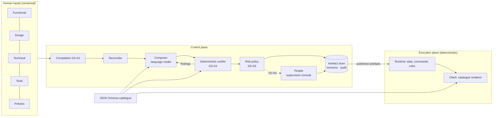
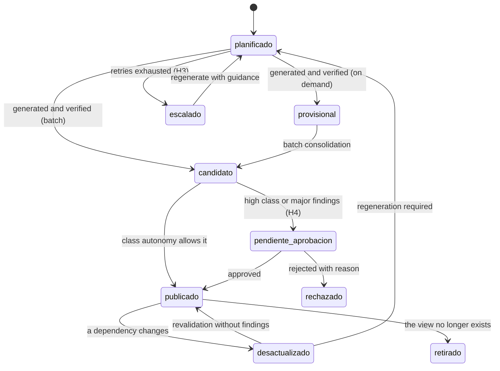

<div align="center">

# Eidos

<sub>εἶδος · the form of which every screen is an instance</sub>

**A specification- and design-driven architecture for the verified construction of business application interfaces with language models**


[](LICENSE)


[Documentation](docs/README.md) · [Architecture](docs/02-arquitectura.md) · [Control points](docs/04-puntos-de-control.md) · [Plan](docs/09-plan-de-trabajo.md) · [References](docs/referencias.md)

**English** · [Español](README.es.md)

</div>

> *What is written is the form; what is seen, one of its instances. The form remains while the instances are regenerated.*

The detailed documentation under [docs/](docs/README.md) is written in Spanish.

---

## Abstract

In business applications, much of the development and maintenance cost lies in translating requirements, rules and design criteria into user interfaces. This work is largely repetitive, and as changes accumulate the code drifts away from the specification it came from. This proof of concept explores an architecture in which **functional, technical, design and test specifications are the primary, versioned artefacts of the project**, and the interface is a **derived artefact**. The aim is to observe how the development cycle behaves when the work centres on specifying and designing: what can be derived, what fails, where a person is needed, and at what cost.

A control plane with language-model agents derives the interface within a closed vocabulary (a component catalogue described in JSON Schema). A deterministic verifier checks it against the specification. A declarative policy, driven by computed risk, decides what is published automatically and what requires human approval. The execution plane is deterministic: models take no part in reading or writing data.

The architecture builds on established results:
- model-driven development with small, narrow languages [R5][R6];
- declarative interfaces over a trusted catalogue [R8][R10];
- schema-constrained decoding [R7];
- repair guided by external feedback rather than self-assessment [R12][R13];
- desired-state reconciliation [R28];
- levels of automation by function and risk [R23].

The reference implementation (≈2,700 lines of Python; ≈600 lines of TypeScript for the client) has been evaluated on two small domains. Results are preliminary and do not support general conclusions. Over 14 views:
- with an open-weight model running locally (gpt-oss:20b), 7 (50 %) passed verification at the first attempt and 9 (64 %) after guided repair;
- with a small commercial model (gpt-4o-mini), 8 (57 %) and 11 (79 %) respectively.

The rest were escalated to a person according to policy. The target for this phase is ≥ 90 % at the first attempt.

**Keywords:** specification-driven development, model-driven engineering, generated user interfaces, language models, verification, human oversight, traceability.

---

## 1. Introduction

### 1.1 Problem

Brooks distinguishes between **essential** complexity, inherent to the problem (data, rules, flows), and **accidental** complexity, arising from the means of implementation [R1]. In business applications, building forms, lists, detail views and confirmations concentrates a great deal of accidental complexity: it is structurally similar across applications, yet each instance is written, tested and maintained by hand.

Lehman's laws further state that a system in use must change continually and that its complexity grows unless work is done to reduce it [R2]. Every functional change currently propagates into interface code. Traceability between requirement, implementation and test, required by ISO/IEC/IEEE 29148 [R18], degrades because it is maintained manually [R19].

### 1.2 Approach

The aim is neither to eliminate programming nor to replace the existing development process. It is to **analyse what happens to the development cycle when effort is centred on specifications and design**:
- whether consistency between what is specified and what is built can be maintained and demonstrated with evidence;
- which part of the work shifts;
- which new costs appear.

In this proof of concept, the team produces and maintains four families of inputs: functional document, design system, technical specification and tests. To these are added the policies that govern automation. The platform derives interface artefacts from them, verifies them, records the evidence and requests human intervention at the points defined by policy.

The division of responsibilities under study is:

| Actor | Responsibility |
|---|---|
| Functional analysts and design | Define requirements, acceptance criteria, patterns and tone; validate the result |
| Development | Maintains the technical specification, business rules and components that do not fit the catalogue; approves high-risk publications |
| AI team | Maintains the platform: agents, verifier, policies and model profiles |
| System | Builds, verifies and repairs derived artefacts, and decides (by declared policy) when to intervene and whom to assign the intervention to |

### 1.3 Contributions of the proof of concept

1. An **artefact model** that separates human inputs (immutable to the system), the compiled specification, and derived artefacts with a lifecycle, declared dependencies and revisions.
2. A **strict separation between control plane** (agents, reconciliation, verification, policy) **and execution plane** (data, commands, rendering), so that no model output acts on data.
3. A **system of gates (G0–G7) and interventions (H1–H6)** whose activation depends on a risk class computed from the specification, not chosen case by case.
4. Mechanisms to **prevent ad hoc drift** of the platform: automated fitness functions [R31] and a second, witness domain.
5. A **reference implementation** open to inspection, with contracts exported as JSON Schema.

---

## 2. Hypothesis and research questions

**Hypothesis.** In business applications of low or medium complexity, if human inputs are precise, verifiable and traceable, a language-model-based generator can produce most views. It must do so constrained to a closed catalogue and verified by a deterministic oracle. Human effort then concentrates on the specification and on a bounded number of approval decisions.

| Id | Question | Metric | Phase target |
|---|---|---|---|
| RQ1 | What proportion of views passes verification without intervention? | % of views valid at first attempt and after repair, per model profile | ≥ 90 % at first attempt |
| RQ2 | Can requirement → specification → view → test traceability be kept without manual work? | % of requirements with a complete chain | 100 % |
| RQ3 | Can human intervention be limited to decisions set by policy? | Interventions per functional change; share justified by a rule | All justified |
| RQ4 | Does the platform remain domain-independent? | Fitness-function violations across two domains | 0 |
| RQ5 | Does the outcome depend on the model provider? | Difference in RQ1 between profiles (local / cloud) | To be measured |
| RQ6 | Is data minimisation upheld with external models? | Real data in prompts to external profiles | 0 |

---

## 3. Background and related work

**Model-driven engineering.** MDA [R3] and MDE [R4] formalised software generation from models. Empirical studies in industry attribute the benefits to small domain-specific languages applied to specific parts of a system, coexisting with hand-written code. Failures arise when everything is modelled [R5][R6]. Eidos adopts those conditions: narrow, validated specifications, a closed catalogue, and a first-class manual route.

**Declarative interfaces.** Server-driven UI systems in production [R10] and recent specifications for agent-generated interfaces, A2UI [R8] and json-render [R9], describe the interface as data interpreted by a client that only knows trusted components. Eidos adopts a flat screen document, aligned with A2UI, with data bindings expressed as JSON Pointers (RFC 6901).

**Constrained generation and correction.** Schema-constrained decoding guarantees syntactic validity [R7], but not semantic validity. Evidence indicates that models do not reliably self-correct without external feedback [R12], and that repair effectiveness depends on the quality of that feedback [R13][R14][R15][R16]. Models used as judges show documented biases [R17]. Hence in Eidos the oracle is deterministic and human-authored, and repair is only triggered by a concrete finding (the *evaluator-optimizer* pattern [R11]).

**Requirements and acceptance.** The requirement quality criteria of ISO/IEC/IEEE 29148 [R18], the executable examples of *Specification by Example* and BDD [R20][R21], and the ubiquitous language of DDD [R22] are adopted. The system checks consistent use of the glossary.

**Human oversight.** The level of automation is assigned by function and risk [R23]. Interventions are kept small and evidence-based to mitigate the ironies of automation [R24][R25], in line with the NIST AI RMF [R26] and Article 14 of the EU AI Act [R27].

**Architecture.** Eidos draws on desired-state reconciliation from Borg/Kubernetes [R28], deployment pipelines with quality gates [R29], fitness functions [R31], information hiding and contracts [R32][R33], and ports and adapters for model providers [R34]. Risks specific to machine-learning systems (undeclared dependencies, glue code) [R35][R36] are addressed with explicit per-artefact dependencies.

### 3.1 Positioning

| Approach | Produces | Maintained by | Difference from Eidos |
|---|---|---|---|
| Classic MDE | Code through fixed transformations | People (models and generators) | The generator interprets natural language and design; output is declarative and verified |
| Visual low-code | Screens composed by hand in an editor | People | There is no screen editor; what is needed is specified, not how it is drawn |
| Specification-guided coding agents (e.g. Spec Kit [R37]) | Source code | People, after generation | Eidos does not generate code: it generates bounded documents that the system itself reconciles and verifies |
| Server-driven UI | Interface documents written by teams | People | Eidos automates authoring under verification and policy |

---

## 4. Architecture

The full description is in [docs/02-arquitectura.md](docs/02-arquitectura.md). This section summarises its elements.

### 4.1 Inputs

Each application is a versioned input bundle (example: [apps/usuarios/](apps/usuarios)). The system does not modify inputs (RP-03); it can only propose changes as an intervention.

| Family | Content | Owner | Format |
|---|---|---|---|
| Functional | Requirements with actor and acceptance criterion; glossary | Functional | Validated YAML |
| Design | Voice and tone, applicable patterns, composition constraints | Design | Validated YAML |
| Technical | Entities, fields, rules, metrics, views, commands | Development | Validated YAML |
| Tests | Conformance tests per view (BDD in Phase 2) | Functional + Development | Validated YAML |
| Policies | Risk classes and autonomy (over platform defaults) | Development | YAML |

### 4.2 Planes and components



The component **catalogue**, defined in JSON Schema, is the single source for three purposes: the model's output schema, the verifier's rules and the renderer's registry. A component that is not in the catalogue cannot be generated, accepted or drawn.

The end user's natural-language **interpreter** translates requests into a declared view and parameters. It does not receive data records; record resolution happens on the server.

### 4.3 Lifecycle of a screen artefact

State names are kept as they appear in the code.



Each revision records its **dependencies by fingerprint**: specification fragment, recipe, catalogue, design system and tests. A change in the inputs only affects artefacts whose fingerprints change. Published artefacts are immutable (RP-06): regeneration requires a dependency change or a recorded human decision, and the published version keeps being served until the new one passes the gates. Details in [docs/03-ciclo-de-vida.md](docs/03-ciclo-de-vida.md).

### 4.4 Quality gates

| Gate | Check | On failure |
|---|---|---|
| G0 Admission | Inputs valid against their schema; requirements identified, with actor and criterion | Version rejected with located errors |
| G1 Compilation | Referential integrity, ambiguities, traceability, fingerprints | H1 (clarify or approve specification) |
| G2 Planning | Pattern, risk class and route (on demand / batch / manual) per view | H2 (high or manual class) |
| G3 Generation | Structured output; structure and component graph; data bindings | Repair with findings, or H3 |
| G4 Verification | Design rules; conformance tests | Repair with findings, or H3 |
| G5 Approval | Class autonomy; requirements with tests (RP-05) | H4 (approve publication) |
| G6 Publication | Complete version; rollback available | Previous version is kept |
| G7 Operation | Runtime signals | Revalidation or H6 |

The verifier distinguishes four severities: blocking, major, minor and auto-fixable. Automatic fixes are deterministic, annotated transformations (normalising structure, flattening nested components, etc.) and do not consume retries.

### 4.5 Risk, autonomy and intervention

The **risk class** (low, medium, high or manual) is computed from the specification: data writes, irreversible operations, permissions, critical rules, number of entities and regions. It is the maximum over all factors. Each class maps to an **autonomy level** (A0–A3) per function [R23]:
- A low-class query view is published without prior approval, with sampled audit.
- A record deletion (high class) requires approval (H4).
- Changing the specification always requires approval (H1).
- The system is never allowed to change tests.

Details in [docs/04-puntos-de-control.md](docs/04-puntos-de-control.md).

### 4.6 Platform invariants (selection)

| Id | Invariant |
|---|---|
| RP-01 | No artefact reaches end users without passing G3 and G4 |
| RP-02 | Agents do not write data; every write is a declared, validated and audited command |
| RP-03 | The system does not modify human inputs |
| RP-04 | No repair without a finding that motivates it |
| RP-05 | A requirement without an approved test blocks publication of its artefacts |
| RP-07 | No real data is sent to external model profiles |
| RP-10 | The platform contains no domain knowledge |

### 4.7 Contracts

Contracts between components are exported to [contracts/](contracts) as JSON Schema 2020-12: compiled specification, view, entity, command, rule, screen document, finding, artefact and intervention. Model adapters (local Ollama, Azure OpenAI and a deterministic reference profile) implement a single interface. Design decisions are recorded as ADRs in [docs/07-decisiones.md](docs/07-decisiones.md).

---

## 5. Reference implementation

| Module | Responsibility |
|---|---|
| [platform/src/eidos/specs](platform/src/eidos/specs) | Admission (G0) and compilation (G1) |
| [platform/src/eidos/catalog](platform/src/eidos/catalog) | Catalogue of 12 components; derived screen schema and prompt |
| [platform/src/eidos/patterns](platform/src/eidos/patterns) | Recipes for collection, record, form and confirmation; deterministic fallback template |
| [platform/src/eidos/agents](platform/src/eidos/agents) | Composer and interpreter |
| [platform/src/eidos/guard](platform/src/eidos/guard) | Layered verifier and conformance tests |
| [platform/src/eidos/policy](platform/src/eidos/policy) | Risk classification and autonomy |
| [platform/src/eidos/reconciler.py](platform/src/eidos/reconciler.py), [kinds.py](platform/src/eidos/kinds.py) | Reconciliation loop per artefact kind |
| [platform/src/eidos/store.py](platform/src/eidos/store.py) | Revisions, interventions and audit (SQLite) |
| [platform/src/eidos/runtime](platform/src/eidos/runtime) | Execution plane: data, filters, metrics, commands and rules |
| [client/src](client/src) | Catalogue renderer and supervision console |

**Evaluation domains:**
- `usuarios` (users): pilot; create, delete, edit, lists and metrics.
- `reservas` (bookings): witness; rooms and bookings with a non-overlap rule.

The witness domain exists to detect pilot-specific knowledge leaking into the platform.

---

## 6. Evaluation method

1. **Batch build per model profile.** For each domain and profile the full reconciliation is run (`eidos build all`). For every view the system records attempts, findings by gate and severity, model, time and final state. The report is stored as JSON and Markdown.
2. **Deterministic baseline.** The `fake` profile produces the fallback template derived from the recipes. It serves as a lower bound on quality and as a control for the verifier.
3. **Fitness functions** ([platform/tests/test_fitness.py](platform/tests/test_fitness.py)), run on every change:
   - F1: no domain vocabulary in the platform;
   - F2/F3: both domains built with the same parts;
   - RP-07: no real data in prompts to external profiles.
4. **Contract, verifier, reconciler, runtime and API tests** (32 cases with pytest).

---

## 7. Preliminary results

**Platform.**
- Automated tests and fitness functions: 32/32 pass, including F1, F2, F3 and RP-07.
- Traceability (RQ2): 10 of 10 requirements (5 per domain) have at least one implementing view and one verifying test. The matrix is computed at G1, and a requirement without a test blocks publication (RP-05).

**Generation by model profile (RQ1, RQ5).** Batch build of the 14 views of both domains; one run per profile.

| Measure | gpt-oss:20b (local, Ollama, enforced schema) | gpt-4o-mini (Azure OpenAI, JSON mode) |
|---|---|---|
| Valid at first attempt | 7/14 (50 %) | 8/14 (57 %) |
| Valid after guided repair | 9/14 (64 %) | 11/14 (79 %) |
| Escalated (H3) | 5/14 | 3/14 |
| Time per attempt | 7–47 s (full build ≈ 8 min) | Not recorded comparably |

Neither profile reaches the phase target (≥ 90 % at first attempt).

**Error analysis.**
- **gpt-4o-mini.** Failures were mostly structural: nested components instead of a flat list, inline children, formatting embedded in data paths, and references to non-existent identifiers.
- **gpt-oss:20b.** All five escalated views are write views, four of them high-class (deletions, and booking creation and edit). Two causes account for all blocking findings:
  - references to undeclared components (`REF_MISSING`, 3 views);
  - inclusion of the identifier as an editable field in edit forms (`FORM_FIELD`, 2 views).

  In the deletion views the same finding recurred unchanged after repair. Precise feedback was therefore not enough to correct it, which points to a limitation of the recipe or prompt rather than of the verifier.

Several structural errors are absorbed by deterministic normalisations in the verifier. This improves the outcome, but also shifts to the verifier part of the credit attributable to the model (see §8).

---

## 8. Limitations and threats to validity

- **Internal validity.**
  - Very small sample (14 views, a single run per profile) and non-deterministic generation; no intervals or statistical comparisons are reported.
  - The two profiles were run at different points of the iteration, with prompt and verifier versions that were not identical, and with different structured-output modes (enforced schema vs JSON mode). The comparison between profiles is indicative only.
  - The same people wrote the specifications, recipes and verifier, which may bias results in favour of the system.
- **Construct validity.**
  - "Valid" means passing the verifier and conformance tests; it does not imply usability or functional acceptance.
  - There are no BDD acceptance tests, consultative judge or user study yet.
- **External validity.**
  - Two CRUD-type domains with few entities.
  - Multi-step flows, external integrations, complex permissions and real data volumes have not been evaluated.
- **Catalogue dependence.** Expressiveness is bounded by the catalogue (12 components); whatever does not fit is classified as manual. The balance between a catalogue that is too narrow (rigid) and one that is too broad (hard to verify) is an open question, monitored with fitness functions (doc. 04 §6).
- **Specification cost.** Whether the effort of writing verifiable specifications pays off compared with programming the views has not been measured. This is the central economic question and requires a comparative study.

### 8.1 Out of scope

- It is not an autonomous system: people define, approve what policy assigns to them, and can roll back any publication.
- It is neither a low-code tool nor a generator of arbitrary source code.
- It does not replace tests or write them on the team's behalf.
- It does not aim to cover 100 % of views; what does not fit follows the manual route within the same architecture.

---

## 9. Future work

Detailed plan in [docs/09-plan-de-trabajo.md](docs/09-plan-de-trabajo.md) and roadmap in [docs/08-hoja-de-ruta.md](docs/08-hoja-de-ruta.md).

1. **Iteration 1.2.**
   - Evaluation battery per profile with repetitions, to estimate variability.
   - Prompt and recipe tuning.
   - Client types generated from the contracts.
   - Continuous integration.
2. **Phase 2.**
   - Verifier layer 4 (policies).
   - BDD acceptance tests as oracle.
   - Consultative judge using a profile different from the composer's.
   - Full H1–H6 interventions with deadlines.
   - Git integration as the source of truth.
   - Streaming events aligned with AG-UI [R38].
3. **Comparative study** of specification effort versus conventional development in a real domain.

---

## 10. Reproduction

**Requirements:**
- Docker.
- Optional, for real models: Ollama with `gpt-oss:20b`, or Azure OpenAI configured in `.env` (template in `.env.example`).

```powershell
.\start.ps1      # platform at http://localhost:8000; builds the applications on start-up
.\stop.ps1       # stops the containers; data is kept in the volume
```

| URL | Use |
|---|---|
| http://localhost:8000 | `usuarios` and `reservas` applications (execution plane) |
| http://localhost:8000/console.html | Supervision console: model profile, build, interventions, artefacts with per-revision preview, regeneration, traceability, audit |

```powershell
docker compose exec plataforma eidos validate usuarios           # G0-G1
docker compose exec plataforma eidos build all -v                # reconciliation and conformance report
docker compose exec plataforma eidos interventions list          # open interventions
docker compose exec plataforma eidos interventions approve <id>  # resolve an intervention
docker compose exec plataforma eidos profile use local|azure|fake
```

Without Docker:

```powershell
cd platform; python -m venv .venv; .\.venv\Scripts\pip install -e ".[dev]"
.\.venv\Scripts\pytest
cd ..\client; npm install; npm run build; cd ..\platform; .\.venv\Scripts\eidos serve
```

The initial profile is set with `EIDOS_PROFILE` (`fake` by default) and can later be changed from the console or the CLI. Build reports are stored in `data/platform/reports/<app>/`.

**Repository layout:**

```
docs/        Approach, architecture, lifecycle, control points, contracts, decisions, plan (Spanish)
apps/        Input bundles: usuarios (pilot), reservas (witness)
platform/    Platform (Python): control and execution planes, CLI, API, tests
client/      Client (TypeScript): catalogue renderer and supervision console
contracts/   Contracts exported as JSON Schema
server/ public/ specs/ scripts/ seeds/   F0 prototype (appendix A)
```

---

## Appendix A. Exploratory prototype F0

The F0 prototype (Node.js, no dependencies) was the proof of concept that preceded this architecture. It is kept until the platform covers its functionality, and it does not start by default.

In F0 the screen was generated at request time, verified with a single repair and cached by intent and specification version. There was no controlled publication, no risk classes, no per-artefact dependencies, and no separation between what was generated and what was approved. These gaps motivated the gates, autonomy policy and lifecycle described in §4.

```powershell
.\start.ps1 -Prototipo   # http://localhost:3000 (requires Ollama with gpt-oss:20b, or Azure in .env)
.\start.ps1 -Demo        # with a simulated model
```

Without Docker: `npm run check-llm` and `npm start` (Node ≥ 22.13). Model and cached-screen administration: `/admin.html`.

Main variables in `.env`:

| Variable | Use |
|---|---|
| `LLM_PROFILE` | Prototype profile (`local` or `azure`) |
| `LLM_PROVIDER`, `LLM_BASE_URL` | Ollama or an OpenAI-compatible server |
| `ROUTER_MODEL`, `COMPOSER_MODEL`, `*_REASONING` | Models and reasoning effort |
| `LLM_NUM_CTX`, `LLM_TIMEOUT_MS`, `LOG_PROMPTS` | Context size, timeout and prompt logging |
| `AZURE_OPENAI_*` | Endpoint, key, deployment and API version (the key goes only in `.env`) |

---

## License

Copyright © 2026 mfcardenas. All rights reserved. No use of any kind is permitted without prior written permission; see [LICENSE](LICENSE).

---

## References

Selection; the full list, with the rationale for each reference, is in [docs/referencias.md](docs/referencias.md).

- [R1] Brooks, F. P. (1987). No Silver Bullet — Essence and Accidents of Software Engineering. *IEEE Computer*, 20(4), 10-19.
- [R2] Lehman, M. M. (1980). Programs, life cycles, and laws of software evolution. *Proceedings of the IEEE*, 68(9), 1060-1076.
- [R3] Object Management Group (2014). *MDA Guide revision 2.0*.
- [R4] Schmidt, D. C. (2006). Model-Driven Engineering. *IEEE Computer*, 39(2), 25-31.
- [R5] Hutchinson, J., Whittle, J., Rouncefield, M., Kristoffersen, S. (2011). Empirical assessment of MDE in industry. *ICSE 2011*, 471-480.
- [R6] Whittle, J., Hutchinson, J., Rouncefield, M. (2014). The State of Practice in Model-Driven Engineering. *IEEE Software*, 31(3), 79-85.
- [R7] Willard, B. T., Louf, R. (2023). Efficient Guided Generation for Large Language Models. arXiv:2307.09702.
- [R8] A2UI — Agent-to-User Interface, specification v0.9. https://a2ui.org
- [R9] Vercel Labs. json-render. https://github.com/vercel-labs/json-render
- [R10] Brooks, R. (2021). A Deep Dive into Airbnb's Server-Driven UI System. Airbnb Engineering.
- [R11] Anthropic (2024). Building effective agents.
- [R12] Huang, J., et al. (2024). Large Language Models Cannot Self-Correct Reasoning Yet. *ICLR 2024*.
- [R13] Olausson, T. X., et al. (2024). Is Self-Repair a Silver Bullet for Code Generation? *ICLR 2024*.
- [R14] Madaan, A., et al. (2023). Self-Refine: Iterative Refinement with Self-Feedback. *NeurIPS 2023*.
- [R15] Shinn, N., et al. (2023). Reflexion: Language Agents with Verbal Reinforcement Learning. *NeurIPS 2023*.
- [R16] Jimenez, C. E., et al. (2024). SWE-bench: Can Language Models Resolve Real-World GitHub Issues? *ICLR 2024*.
- [R17] Zheng, L., et al. (2023). Judging LLM-as-a-Judge with MT-Bench and Chatbot Arena. *NeurIPS 2023*.
- [R18] ISO/IEC/IEEE 29148:2018. Requirements engineering.
- [R19] Gotel, O., Finkelstein, A. (1994). An analysis of the requirements traceability problem. *ICRE '94*, 94-101.
- [R20] Adzic, G. (2011). *Specification by Example*. Manning.
- [R21] North, D. (2006). Introducing BDD. *Better Software*.
- [R22] Evans, E. (2003). *Domain-Driven Design*. Addison-Wesley.
- [R23] Parasuraman, R., Sheridan, T. B., Wickens, C. D. (2000). A model for types and levels of human interaction with automation. *IEEE Trans. SMC-A*, 30(3), 286-297.
- [R24] Bainbridge, L. (1983). Ironies of automation. *Automatica*, 19(6), 775-779.
- [R25] Amershi, S., et al. (2019). Guidelines for Human-AI Interaction. *CHI 2019*.
- [R26] NIST (2023). *AI Risk Management Framework (AI RMF 1.0)*. NIST AI 100-1.
- [R27] Regulation (EU) 2024/1689 (Artificial Intelligence Act), Article 14.
- [R28] Burns, B., et al. (2016). Borg, Omega, and Kubernetes. *ACM Queue*, 14(1).
- [R29] Humble, J., Farley, D. (2010). *Continuous Delivery*. Addison-Wesley.
- [R31] Ford, N., Parsons, R., Kua, P. (2017). *Building Evolutionary Architectures*. O'Reilly.
- [R32] Parnas, D. L. (1972). On the criteria to be used in decomposing systems into modules. *CACM*, 15(12), 1053-1058.
- [R33] Meyer, B. (1992). Applying "Design by Contract". *IEEE Computer*, 25(10), 40-51.
- [R34] Cockburn, A. (2005). Hexagonal Architecture (Ports and Adapters).
- [R35] Sculley, D., et al. (2015). Hidden Technical Debt in Machine Learning Systems. *NeurIPS 2015*.
- [R36] Amershi, S., et al. (2019). Software Engineering for Machine Learning: A Case Study. *ICSE-SEIP 2019*.
- [R37] GitHub (2025). Spec Kit. https://github.com/github/spec-kit
- [R38] AG-UI — Agent-User Interaction Protocol. https://docs.ag-ui.com
