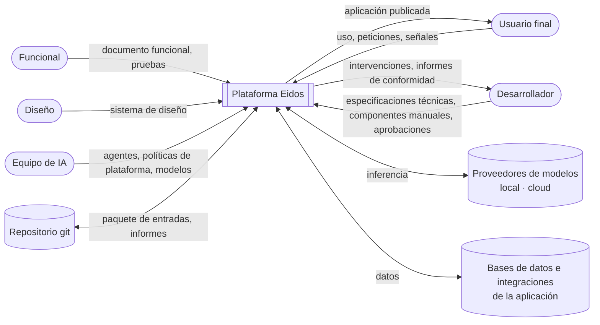
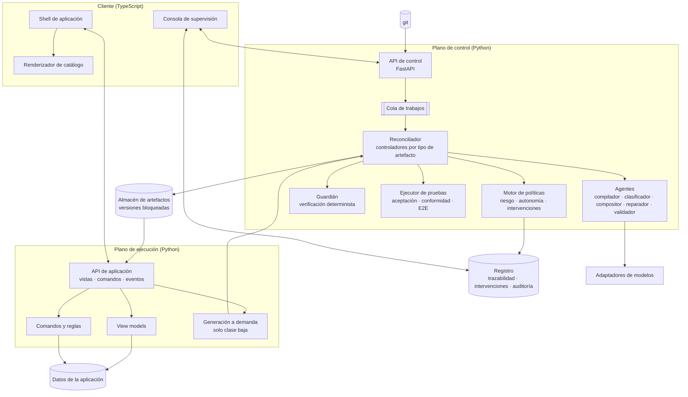
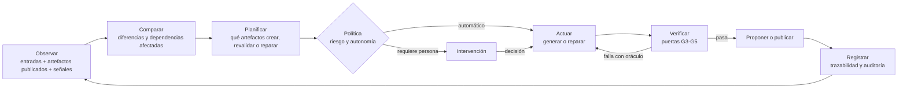
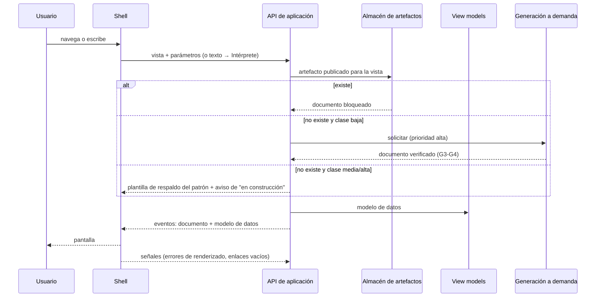

# 02 · Arquitectura

## 1. Vista general

La arquitectura se organiza en **dos planos** y **un contrato**:

- **Plano de control**: construye, verifica, repara y publica artefactos a partir de las entradas. Es donde trabajan los agentes. Se ejecuta en lote (CI o trabajadores) y, de forma acotada, a demanda.
- **Plano de ejecución**: sirve la aplicación a los usuarios finales con artefactos ya publicados y código determinista. No improvisa.
- **Contrato**: esquemas versionados (JSON Schema) que definen entradas, catálogo, documentos de pantalla, comandos y eventos. Los dos planos y el renderizador solo se conocen a través de él.

Esta separación es la que usan los orquestadores de contenedores (plano de control con controladores que reconcilian estado; plano de datos que ejecuta) [R28], y es la que permite que el equipo de IA evolucione los agentes sin afectar a la aplicación en producción.

### 1.1 Contexto (C4 nivel 1 [R41])



### 1.2 Contenedores (C4 nivel 2)



| Contenedor | Responsabilidad | Escala |
|---|---|---|
| API de control | Recibe paquetes de entradas (desde git/CI), expone estado, intervenciones e informes | Sin estado, horizontal |
| Reconciliador | Ejecuta el bucle observar → comparar → planificar → actuar → verificar → registrar | Trabajadores en paralelo por artefacto |
| Agentes | Tareas con modelo: compilar especificación, clasificar, componer, reparar, evaluar | Limitados por cuota del proveedor |
| Guardián | Verificación determinista de artefactos contra contratos y políticas | Sin estado, CPU |
| Ejecutor de pruebas | Ejecuta pruebas de aceptación, de conformidad y E2E sobre una versión candidata | Trabajadores aislados |
| Motor de políticas | Calcula clase de riesgo, nivel de autonomía y decide si hace falta intervención | Sin estado |
| API de aplicación | Sirve pantallas publicadas, datos y comandos; emite eventos | Sin estado, horizontal, cacheable |
| Generación a demanda | Para vistas de clase baja sin artefacto: delega en el reconciliador con prioridad alta | Acotada por política |
| Renderizador | Pinta documentos de pantalla con el catálogo; no conoce dominios | Estático (CDN) |
| Consola de supervisión | Intervenciones, informes, diferencias, trazabilidad, perfiles de modelo | — |
| Almacén de artefactos | Versiones inmutables y bloqueadas de cada artefacto | Base de datos + almacenamiento de objetos |
| Registro | Trazabilidad, intervenciones, decisiones y auditoría | Solo inserción |

## 2. El patrón central: reconciliación por tipos de artefacto

### 2.1 Bucle de reconciliación



El bucle es **idempotente**: si el estado real ya coincide con el deseado, no hace nada. Se dispara por:

- un nuevo paquete de entradas (commit en git);
- un cambio en una dependencia (catálogo, modelo, esquema de datos, librería del renderizador);
- una señal del plano de ejecución (error de renderizado, enlace vacío, petición sin artefacto);
- una decisión humana (intervención resuelta).

### 2.2 Tipos de artefacto: el punto de extensión

Todo lo que produce el sistema es un **tipo de artefacto** registrado con la misma interfaz. Es la pieza que impide que la plataforma crezca con caminos especiales para cada aplicación:

```python
class ArtifactKind(Protocol):
    name: str                                  # "screen", "migration", "test-proposal", "spec"
    schema: JsonSchema                         # contrato del artefacto
    def dependencies(self, spec: CompiledSpec, key: str) -> DependencySet: ...
    def plan(self, desired: CompiledSpec, actual: ArtifactStore) -> list[Change]: ...
    def generate(self, change: Change, ctx: GenContext) -> Draft: ...
    def verify(self, draft: Draft, ctx: VerifyContext) -> list[Finding]: ...
    def risk(self, change: Change, spec: CompiledSpec) -> RiskClass: ...
    def repair(self, draft: Draft, findings: list[Finding], ctx: GenContext) -> Draft: ...
```

| Tipo | Genera | Verifica con | Riesgo por defecto |
|---|---|---|---|
| `spec` | Especificación compilada a partir de documento funcional + técnico | Esquema de especificación, integridad referencial, ambigüedades | Alto (siempre aprobación humana) |
| `plan` | Plan de construcción: vistas, clase, ruta, dependencias | Reglas de clasificación | Medio |
| `screen` | Documento de pantalla | Guardián + pruebas de conformidad + aceptación + juez consultivo | Según vista |
| `migration` | Plan de migración de datos | Simulación sobre copia, reversibilidad | Alto |
| `test-proposal` | Borrador de prueba para requisitos sin cubrir | Sintaxis, referencia a requisito | Alto (solo propuesta) |
| `report` | Informe de conformidad y matriz de trazabilidad | — | — |

Añadir una capacidad nueva (p. ej. generar plantillas de correo o informes PDF) es **registrar un tipo de artefacto**, no modificar el reconciliador.

## 3. Componentes del plano de control

### 3.1 Agentes

Cada agente es una función con **entrada y salida tipadas** (Pydantic → JSON Schema), un prompt **derivado de contratos** (nunca texto de dominio escrito en código) y salida estructurada obligatoria [R7]. Siguiendo la recomendación de mantener los sistemas agénticos tan simples como sea posible y usar flujos definidos antes que agentes abiertos [R11], cada agente tiene una tarea acotada:

| Agente | Entrada | Salida | Nota |
|---|---|---|---|
| **Compilador de especificaciones** | Documento funcional + especificaciones técnicas + glosario | Especificación compilada + lista de ambigüedades + preguntas | Nunca publica: siempre H1 |
| **Clasificador** | Especificación compilada | Plan: vistas, patrón, clase de riesgo propuesta, ruta | La clase final la fija el motor de políticas |
| **Planificador de regiones** | Vista + patrón | Regiones y su modelo de datos | Solo para vistas complejas |
| **Compositor** | Patrón/región + catálogo + esquema del modelo de datos | Documento de pantalla | Salida restringida al esquema |
| **Reparador** | Artefacto + hallazgos de verificación | Artefacto corregido | Solo con hallazgos; nunca toca pruebas ni entradas |
| **Validador consultivo** | Artefacto + requisito + receta + rúbrica | Puntuación por criterio + motivos | No aprueba; aporta señales |
| **Intérprete** (ejecución) | Texto del usuario + esquema (sin datos reales) | Vista + parámetros | Usa herramientas de búsqueda para resolver registros |

### 3.2 Guardián (verificación determinista)

Cuatro capas, cada una produce **hallazgos** `{código, severidad, ruta, mensaje, autocorregible}`:

1. **Estructura**: validación JSON Schema del documento y de cada componente.
2. **Enlaces**: cada ruta de datos existe en el esquema del modelo de datos de la vista; cada vista, comando y acción referenciados existen.
3. **Diseño**: reglas del sistema de diseño (acción primaria única, acciones destructivas solo en confirmación, profundidad y número de nodos máximos, jerarquía de títulos).
4. **Políticas**: permisos de quien verá la pantalla, campos sensibles, accesibilidad mínima (etiquetas, contraste por tokens).

Las reglas del guardián son **datos** (definidas en el sistema de diseño y en políticas), no código específico por pantalla.

### 3.3 Ejecutor de pruebas

| Tipo de prueba | Sobre qué | Herramienta orientativa |
|---|---|---|
| **Conformidad estática** | Documento de pantalla (sin navegador): "tiene acción primaria de alta", "muestra columnas X" | Aserciones declarativas en YAML sobre el documento |
| **Aceptación funcional** | Comportamiento de la aplicación: Dado/Cuando/Entonces | pytest-bdd o behave sobre la API de aplicación |
| **Extremo a extremo** | Interfaz real en navegador | Playwright con selectores semánticos (rol, etiqueta) |
| **Regresión visual** (opcional) | Captura frente a la referencia aprobada | Playwright + comparación de imágenes |

### 3.4 Motor de políticas

Lee **políticas declaradas** (ficheros versionados, propiedad de las personas) y decide:

- la **clase de riesgo** de cada cambio (reglas en [04 · Puntos de control](04-puntos-de-control.md#3-clasificación-y-autonomía));
- el **nivel de autonomía** aplicable;
- si un resultado requiere **intervención**, de qué tipo, a qué rol y con qué plazo.

## 4. Plano de ejecución

### 4.1 Flujo de una petición



### 4.2 View models y comandos

- **View models**: consultas declaradas en la especificación técnica (selección, filtro, agregación, relación). Producen el modelo de datos de la vista **y su esquema**, que el guardián usa para validar enlaces.
- **Comandos**: única vía de escritura. Entrada validada contra el esquema de la entidad, reglas de negocio por identificador, permisos y auditoría. Los destructivos requieren confirmación explícita del usuario (evento de interrupción).
- **Repositorios**: adaptadores por almacén (SQLite en laboratorio, PostgreSQL u otra API en producción) [R34].

### 4.3 Cliente

- **Renderizador**: registro `componente → implementación`; motor de enlaces (JSON Pointer [RFC 6901], plantillas de lista, condiciones acotadas); estado local de formularios. No evalúa código ni conoce dominios.
- **Shell**: navegación, barra de peticiones, historial, sesión.
- **Tema**: generado desde los tokens de diseño (formato DTCG).
- **Consola de supervisión**: intervenciones, informes, diferencias, trazabilidad, previsualización con el mismo renderizador.

## 5. Contratos y protocolos

| Contrato | Formato | Alineado con |
|---|---|---|
| Paquete de entradas | Markdown estructurado + YAML/JSON con esquema | ISO 29148 [R18], BDD [R21] |
| Especificación compilada | JSON con esquema versionado | — |
| Catálogo de componentes | Un JSON Schema por componente + metadatos para el modelo | json-render [R9], A2UI [R8] |
| Documento de pantalla | Lista plana de componentes con `id`, valores literales o `{path}` | A2UI [R8] |
| Eventos cliente-servidor | NDJSON/SSE con tipos estables (inicio, paso, superficie, estado, interrupción, error) | AG-UI [R38] |
| Comandos | JSON con esquema de entrada por comando | — |
| Hallazgos | `{código, severidad, ruta, mensaje, autocorregible}` | Errores de validación de A2UI [R8] |

Detalle de formatos en [05 · Contratos](05-contratos.md).

## 6. Escalabilidad

| Dimensión | Cómo escala |
|---|---|
| **Usuarios finales** | El plano de ejecución sirve artefactos inmutables: API sin estado, caché HTTP y CDN para el renderizador. La generación a demanda está limitada a clase baja y con cuota. |
| **Número de pantallas** | Reconciliación incremental por dependencias: un cambio solo afecta a los artefactos que dependen de la parte cambiada (huellas por fragmento de especificación). |
| **Complejidad de pantallas** | Patrones y regiones: una pantalla grande se genera, verifica y repara por regiones independientes. |
| **Número de aplicaciones** | Multi-aplicación: cada paquete de entradas es una aplicación aislada (artefactos, datos, políticas, perfiles de modelo propios) sobre la misma plataforma. |
| **Equipos** | Contratos versionados: funcionales, diseño, desarrollo e IA trabajan en ficheros distintos con revisión en git. |
| **Modelos** | Adaptadores por proveedor; asignación de modelo por agente; evaluación con varios perfiles. |
| **Coste** | Generación por lotes fuera de horas punta, caché de artefactos, modelos pequeños para tareas simples (intérprete, clasificador). |

## 7. Pila tecnológica propuesta

| Capa | Elección | Motivo |
|---|---|---|
| Plano de control y de ejecución | **Python 3.12+, FastAPI, Pydantic v2** | Ecosistema de IA del equipo; Pydantic genera JSON Schema para contratos y salida estructurada |
| Trabajos | Cola ligera (p. ej. Arq/RQ sobre Redis) o el propio CI en modo lote | Simplicidad; ampliable |
| Persistencia | SQLAlchemy + **Alembic** (migraciones revisables) · SQLite (lab) / PostgreSQL (prod) | Migraciones generadas, revisadas y reversibles |
| Pruebas | pytest, pytest-bdd, Playwright | Estándar del sector |
| Cliente | **TypeScript** sin framework pesado (Web Components o Lit) | Renderizador pequeño y estable; tipos generados desde los esquemas |
| Modelos | Adaptadores: Ollama, Azure OpenAI, compatible OpenAI | Ya implementado en el prototipo |
| Observabilidad | OpenTelemetry (trazas de agentes y pasos), registro de auditoría | Trazabilidad de decisiones |
| Entrega | Git + CI (GitHub Actions o equivalente) ejecutando el plano de control en modo lote | Reutilizar herramientas existentes |

## 8. Seguridad

- **Sin ejecución de código generado.** El cliente solo pinta componentes del catálogo [R8].
- **Escritura solo por comandos** declarados, validados y con permisos.
- **Minimización de datos**: los prompts llevan esquemas y ejemplos sintéticos; los registros reales nunca van a modelos cloud (política por perfil).
- **Entradas del usuario como datos**: delimitadas en prompts; la salida del intérprete se valida contra la especificación (mitiga inyección de prompts).
- **Secretos solo en servidor**; perfiles de modelo sin claves en el cliente.
- **Auditoría** de toda publicación, reparación e intervención.

## 9. Observabilidad

| Señal | Uso |
|---|---|
| Traza por ejecución del reconciliador (pasos, agentes, hallazgos, duración, tokens, coste) | Depuración y coste |
| Métricas de calidad por perfil y versión (válido a la primera, reparaciones, puntuación del juez, pruebas superadas) | Comparar modelos y detectar regresiones |
| Señales de ejecución (errores de renderizado, enlaces vacíos, abandonos, peticiones sin artefacto) | Disparar revalidación o reparación |
| Intervenciones (tiempo de resolución, % aprobadas sin cambios) | Ajustar políticas y detectar aprobación rutinaria [R24] |
