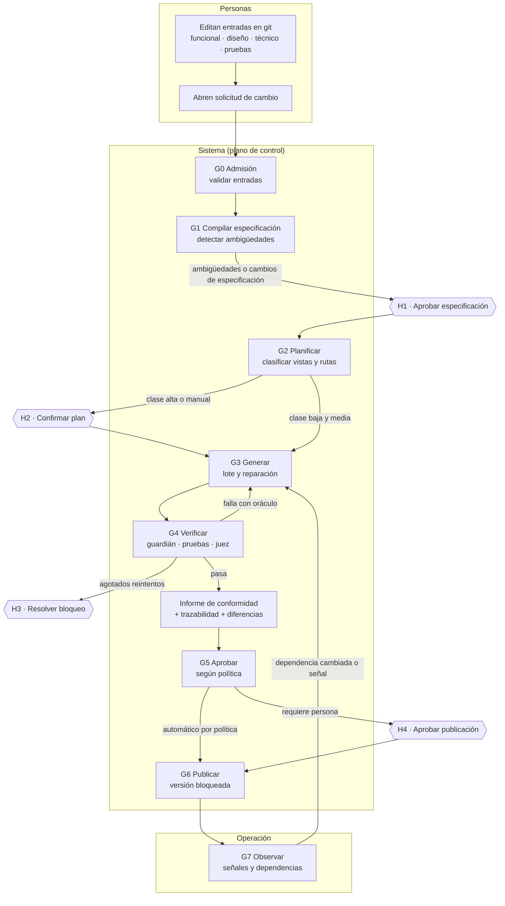
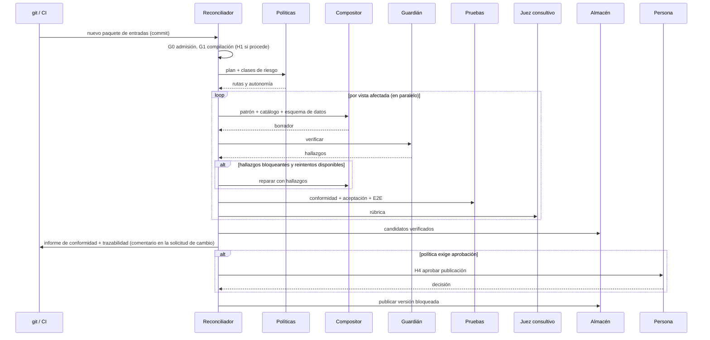
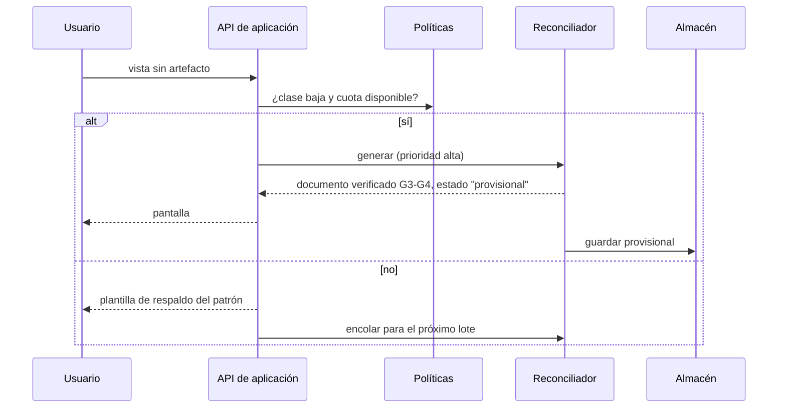
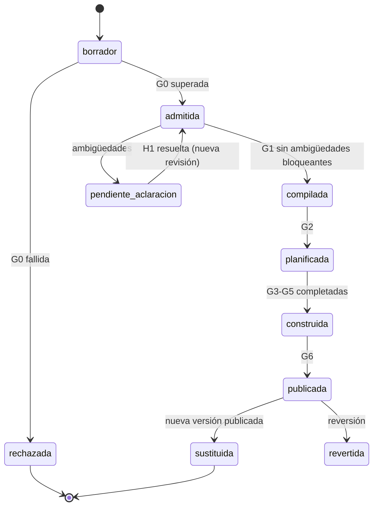
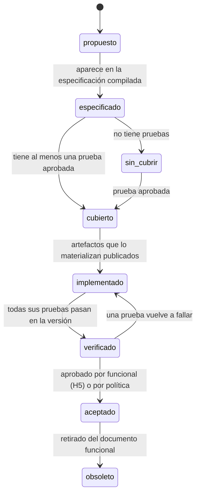
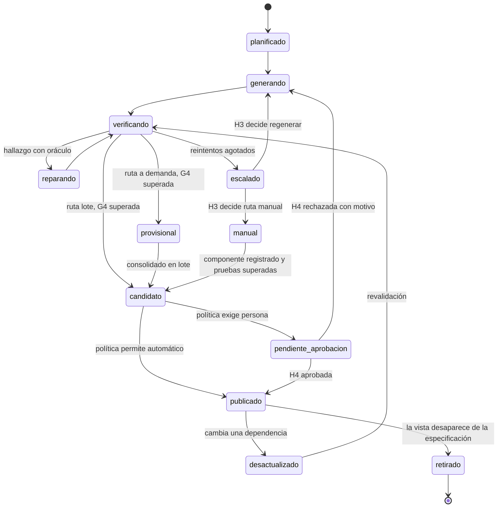
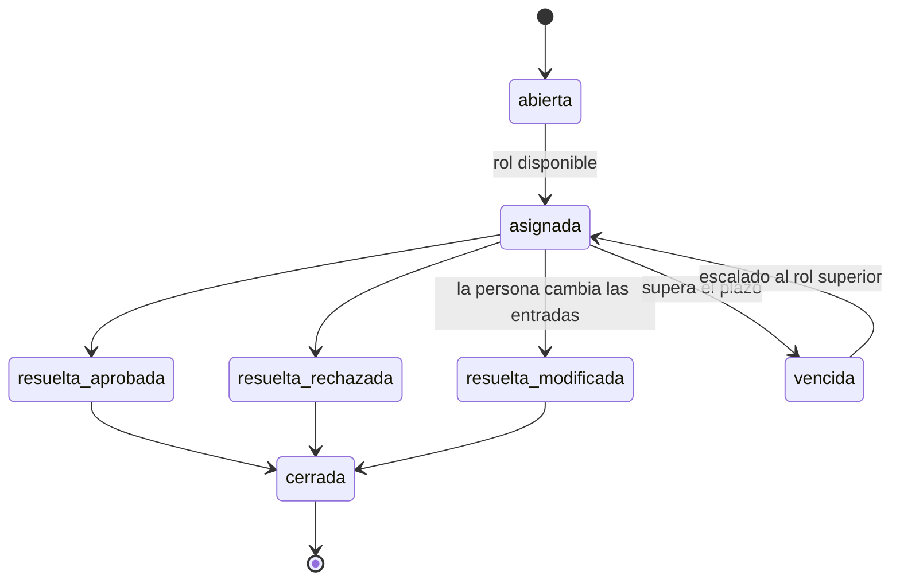
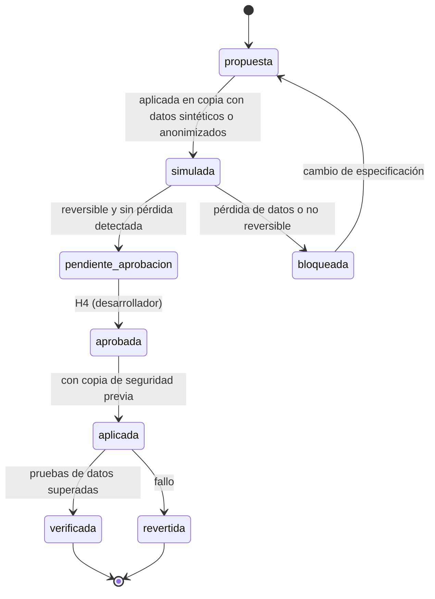

# 03 · Ciclo de vida y estados

## 1. Ciclo completo de un cambio

Los nodos `H#` son **intervenciones**: el sistema se detiene, crea una solicitud con contexto y espera una decisión registrada. Su catálogo completo está en [04 · Puntos de control](04-puntos-de-control.md#4-catálogo-de-intervenciones).

## 2. Rutas de construcción

| Ruta | Cuándo (decidido por política) | Momento | Verificación | Publicación |
|---|---|---|---|---|
| **Lote** | Clase media y alta, o cualquier vista declarada en la especificación | Al publicar un paquete de entradas (CI) | Completa: G3-G5 + pruebas de aceptación y E2E | Automática (media) o con H4 (alta) |
| **A demanda** | Clase baja: vistas de solo lectura, filtros, resúmenes, peticiones libres | En ejecución, cuando un usuario la pide y no existe | G3-G4 (guardián + conformidad + juez) | Se muestra al usuario; queda como *provisional* hasta el siguiente lote, donde se verifica completa y se consolida |
| **Manual** | La vista requiere una capacidad que no ofrece el catálogo | El desarrollador crea un componente y lo registra en el catálogo | Las mismas pruebas que cualquier vista + revisión de código | Con la versión |

Una vista **nunca** cambia de ruta por decisión del agente: si el clasificador propone otra clase, se registra como sugerencia para H2.

### 2.1 Construcción por lotes

### 2.2 Construcción a demanda

## 3. Máquinas de estado

### 3.1 Versión del paquete de entradas

### 3.2 Requisito (trazabilidad)

Un requisito `sin_cubrir` **bloquea la publicación** de los artefactos que lo implementan (regla RP-05).

### 3.3 Artefacto de pantalla

Reglas del ciclo:

- **publicado** es inmutable. Cualquier cambio crea una nueva revisión del artefacto.
- **desactualizado** sigue sirviéndose hasta que su sustituto esté publicado (no hay huecos para el usuario).
- **reparando** solo se alcanza desde un hallazgo concreto (prueba, regla o señal). Sin hallazgo no hay reparación.
- El número máximo de reintentos lo fija la política por clase (por defecto: baja 2, media 2, alta 1).

### 3.4 Intervención

Toda resolución requiere **motivo** cuando es rechazo o modificación; queda en el registro de auditoría con la evidencia que se mostró.

### 3.5 Migración de datos

## 4. Revalidación por dependencias

Cada artefacto publicado guarda su **conjunto de dependencias** con huellas:

| Dependencia | Ejemplo | Huella |
|---|---|---|
| Fragmento de especificación | Entidad `Usuario`, vista `user.list`, regla `ultimoAdminActivo` | Hash del fragmento, no de toda la especificación |
| Catálogo | `Table@1.2`, `Card@1.0` | Versión por componente |
| Sistema de diseño | Reglas y receta del patrón `collection` | Hash |
| Pruebas | Pruebas que lo cubren | Hash |
| Perfil de modelo | `azure/gpt-4o-mini@2024-07-18` | Identificador |
| Esquema de datos | Esquema del modelo de datos de la vista | Hash |
| Renderizador | Versión mayor del contrato | Semver [R39] |

Cuando cambia una huella, el reconciliador marca el artefacto como **desactualizado** y lo **revalida**. Solo si la revalidación falla se regenera o repara. Este es el mecanismo de **"reparar antes de que el usuario vea el problema"**.

Un cambio del perfil de modelo **no** invalida artefactos publicados por defecto (están bloqueados). Sí dispara la evaluación del nuevo perfil y, si la política lo indica, una regeneración comparativa que pasa por H4.
