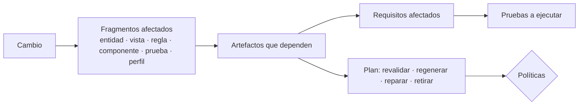

# 06 · Mantenimiento

El mantenimiento es donde la propuesta aporta más valor y donde más riesgos tiene. El principio: **todo cambio entra como cambio de entradas o de dependencias, y sigue el mismo ciclo** (G0-G7). No hay mantenimiento "por fuera".

## 1. Análisis de impacto

Cada artefacto publicado conoce sus dependencias con huellas por fragmento ([03 · §4](03-ciclo-de-vida.md#4-revalidación-por-dependencias)). Ante cualquier cambio, el reconciliador calcula:

El resultado forma parte del informe de conformidad: **qué cambia, por qué y qué se ha comprobado**.

## 2. Escenarios

### 2.1 Cambia un requisito funcional

| Paso | Qué ocurre |
|---|---|
| Disparador | Funcional edita `REQ-003` (p. ej. "el departamento pasa a ser obligatorio") |
| G0-G1 | Se recompila; diferencia en la especificación → **H1** (funcional confirma la interpretación; desarrollador confirma el impacto técnico) |
| Impacto | Entidad `Usuario` (campo `departamento.requerido`), vistas `user.create`, `user.edit`, comando `usuario.crear`, pruebas de `REQ-003` |
| Pruebas | Si el requisito cambia su criterio de aceptación, **las personas** actualizan la prueba (el sistema puede proponer el borrador, A0) |
| G3-G5 | Revalidación de vistas afectadas; las que fallan se regeneran o reparan |
| Datos | Si hay registros sin departamento → migración propuesta (H4, ver 2.2) |

### 2.2 Cambia el modelo de datos

| Tipo de cambio | Acción del sistema | Autonomía |
|---|---|---|
| Añadir campo opcional | Migración aditiva propuesta; revalidar vistas de la entidad | A0 para la migración; A2/A3 para las vistas |
| Añadir campo obligatorio | Migración con valor por defecto o relleno; **simulación** sobre copia; propuesta | A0 |
| Renombrar campo | Migración con copia de datos + periodo de compatibilidad; vistas regeneradas | A0 |
| Eliminar campo o entidad | Migración destructiva **bloqueada** salvo aprobación explícita con copia de seguridad | A0 + H4 |
| Cambiar tipo | Simulación de conversión; informe de valores no convertibles | A0 + H4 |

Las migraciones se generan con herramientas estándar revisables (p. ej. Alembic) y siguen la máquina de estados de [03 · §3.5](03-ciclo-de-vida.md#35-migración-de-datos). Nunca las aplica un agente sin aprobación (RP-08).

### 2.3 Cambia el sistema de diseño

| Cambio | Impacto | Acción |
|---|---|---|
| Tokens (colores, espacios, tipografía) | Ninguno en artefactos: el tema se aplica en el cliente | Publicación directa del tema; pruebas visuales opcionales |
| Voz y tono | Textos de todas las pantallas | Revalidación con el juez (criterio *tono*); regeneración de las que caen bajo umbral |
| Receta de un patrón | Vistas de ese patrón | Revalidación con pruebas de conformidad; regeneración de las que fallan |
| Regla de diseño del guardián | Todas las vistas | Revalidación; las que incumplen se reparan |

### 2.4 Cambia el catálogo de componentes

| Cambio | Versionado | Acción |
|---|---|---|
| Nuevo componente | Menor | Disponible para nuevas generaciones; no afecta a publicadas |
| Nueva propiedad opcional | Menor | Compatible; no afecta |
| Propiedad eliminada o renombrada | **Mayor** | Migrador de documentos (determinista) o regeneración de artefactos afectados; H4 si es de clase alta |
| Cambio de comportamiento visual | Parche/menor | Pruebas visuales en artefactos que lo usan |

El renderizador soporta la versión mayor anterior durante un periodo de transición (F12).

### 2.5 Actualización de librerías

Es mantenimiento **de código**, no de pantallas, y sigue el proceso estándar de ingeniería:

| Ámbito | Proceso |
|---|---|
| Plataforma (Python) | Bot de dependencias → CI de plataforma: pruebas + funciones de aptitud F1-F12 + **dominio testigo** completo → revisión del equipo de IA |
| Renderizador (TypeScript) | Bot de dependencias → pruebas de componentes + E2E de las aplicaciones activas → revisión |
| Aplicación (componentes manuales) | Igual que cualquier código del desarrollador |

Un agente de código puede **proponer** el cambio (abrir la solicitud con el arreglo de una rotura), pero entra por revisión y pruebas como cualquier otra contribución.

### 2.6 Cambia o se actualiza el modelo

| Situación | Acción |
|---|---|
| Nueva versión del modelo en el mismo perfil | Batería de evaluación con el nuevo modelo; **no** se regeneran artefactos publicados (están bloqueados) |
| Cambio de perfil para un agente | Evaluación comparativa; si la política lo pide, regeneración en paralelo y comparación → H4 |
| Proveedor caído | Artefactos publicados siguen sirviéndose; generación a demanda usa la plantilla de respaldo |

### 2.7 Se añade una prueba

Una prueba nueva aprobada es una dependencia nueva de los artefactos que la cubren: se ejecuta en la siguiente reconciliación. Si falla, el artefacto pasa a **desactualizado** y se repara con la prueba como oráculo. Es la forma más directa de **corregir el comportamiento sin tocar pantallas**: el desarrollador escribe la prueba que falla y el sistema hace el resto.

### 2.8 Incidencia en producción

| Señal | Respuesta automática | Si no basta |
|---|---|---|
| Error de renderizado (componente o propiedad inválida) | Revalidación inmediata; reparación si hay hallazgo | H6 |
| Enlace vacío recurrente (ruta sin dato) | Revalidación contra el esquema del modelo de datos | H6 |
| Petición frecuente sin artefacto | Encolar vista para el próximo lote; proponer vista declarada (H2) | — |
| Abandono anómalo en una pantalla | Informe al desarrollador | H6 |
| Reporte de usuario | Registro vinculado al artefacto y requisito | Cambio funcional |

## 3. Reversión

Toda publicación es reversible en un paso: el almacén conserva la versión anterior de cada artefacto y la publicación es un puntero a un conjunto bloqueado. Las migraciones de datos tienen su propia reversión probada en simulación.

## 4. Lo que no se mantiene solo

| Ámbito | Por qué |
|---|---|
| Interpretación de requisitos nuevos | La ambigüedad se resuelve con personas (H1) |
| Pruebas | Son el oráculo; si las mantiene el sistema dejan de serlo (RP-03) |
| Migraciones destructivas | Riesgo irreversible |
| Componentes manuales | Son código del desarrollador |
| Políticas de riesgo y autonomía | Definen el contrato de supervisión |
