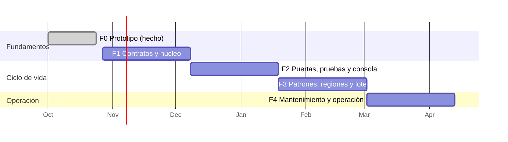

# 08 · Hoja de ruta y piloto

## 1. Estrategia

Construir la plataforma **de forma incremental y demostrable**, validando cada capacidad con dos dominios desde el principio:

- **Dominio piloto:** gestión de usuarios (el del prototipo). Sirve para demostrar valor.
- **Dominio testigo:** reservas de salas (entidades `Sala`, `Reserva`, relación y regla de solapamiento). Sirve para demostrar que la plataforma **no** está hecha a medida (F2).

Cada fase termina con un **criterio de salida medible**. No se empieza la siguiente sin cumplirlo.

## 2. Fases

Las duraciones son orientativas para planificar el debate; se ajustarán con el equipo.

| Fase | Objetivo | Entregables | Criterio de salida |
|---|---|---|---|
| **F0 · Prototipo** (hecho) | Demostrar la idea | CRUD generado, intérprete, compositor, guardián, caché, consola, perfiles local/Azure | Funciona de punta a punta |
| **F1 · Contratos y núcleo** | Base tipada y genérica | Esquemas: paquete de entradas, especificación compilada, catálogo, documento de pantalla, hallazgo · Plataforma en Python (FastAPI + Pydantic) · Renderizador TypeScript con tipos generados · Reconciliador con `ArtifactKind` (`spec`, `screen`) · Salida estructurada · Guardián capas 1-2 · Intérprete sin datos reales · F1, F3, F10 | Piloto y testigo construidos desde sus entradas; 0 datos reales en prompts cloud; ≥ 90 % válidos a la primera con 2 perfiles |
| **F2 · Puertas, pruebas y consola** | Supervisión real | G0-G6 · Guardián capas 3-4 · Pruebas de conformidad y aceptación (pasos genéricos) · Juez consultivo · Motor de políticas, clases y autonomía · Intervenciones H1-H5 · Informe de conformidad en la solicitud de cambio · Trazabilidad · F4, F6 | Un cambio funcional del piloto llega a publicación sin escribir código de interfaz, con todas las intervenciones justificadas por política |
| **F3 · Patrones, regiones y lote** | Pantallas complejas | Biblioteca de patrones (`collection`, `record`, `form`, `confirm`, `dashboard`, `master-detail`, `wizard`) · Regiones y planificador · Construcción por lotes en CI · Generación a demanda acotada · Componentes manuales registrados · F5, F7, F8, F9 | Pantalla multi-entidad del testigo generada por regiones; un componente manual integrado sin tocar la plataforma |
| **F4 · Mantenimiento y operación** | Ciclo de vida completo | Revalidación por dependencias · Migraciones propuestas y simuladas (`migration`) · Señales de ejecución y H6 · Reversión · Auditoría por muestreo · Métricas de calidad por perfil · F11, F12 | Los escenarios de [06 · Mantenimiento](06-mantenimiento.md) ejecutados en el piloto y el testigo |

## 3. Qué se conserva del prototipo

| Pieza del prototipo | Destino |
|---|---|
| Specs en JSON (`app`, `design`, `catalog`) | Se dividen en el paquete de entradas (funcional / diseño / técnico) |
| Intérprete, compositor, guardián | Se reescriben en Python con contratos tipados; se conserva la lógica de reglas como datos |
| Perfiles de modelo (local / Azure) | Se mantienen y amplían con política de datos |
| Consola de administración | Evoluciona a consola de supervisión (intervenciones, informes, trazabilidad) |
| Renderizador | Se reescribe en TypeScript sobre el nuevo documento de pantalla |
| Docker y scripts | Se mantienen para el entorno de laboratorio |

## 4. Indicadores del piloto

| Indicador | Objetivo |
|---|---|
| Pantallas del piloto construidas sin código humano | ≥ 80 % |
| Válidas a la primera (por perfil) | ≥ 90 % |
| Requisitos con trazabilidad completa | 100 % |
| Cambio funcional aprobado → publicado | < 1 día |
| Intervenciones por cambio funcional | Todas justificadas por política; tendencia descendente |
| Funciones de aptitud en rojo | 0 |
| Datos reales en prompts cloud | 0 |

## 5. Preguntas abiertas para el debate

1. **Formato del documento funcional.** ¿Markdown con cabecera (propuesto) o una herramienta de requisitos existente con exportación?
2. **Quién escribe las pruebas de aceptación.** ¿Funcional con apoyo del desarrollador (propuesto) o el desarrollador a partir de los criterios?
3. **Umbrales de las políticas.** Clases de riesgo, porcentaje de muestreo, plazos de intervención: ¿valores iniciales razonables?
4. **Aceptación funcional (H5).** ¿Para todos los requisitos o solo los de criticidad alta?
5. **Modelos.** ¿Qué perfiles se permiten para cada agente y con qué política de datos en el entorno corporativo?
6. **Consola o git.** ¿Las intervenciones se resuelven en la consola, en la solicitud de cambio de git, o en ambos?
7. **Alcance del renderizador.** ¿Web solamente, o se prevé otro cliente (móvil, Teams) que justifique adoptar A2UI completo antes?
8. **Dominio testigo.** ¿Reservas de salas u otro dominio más cercano al negocio?
